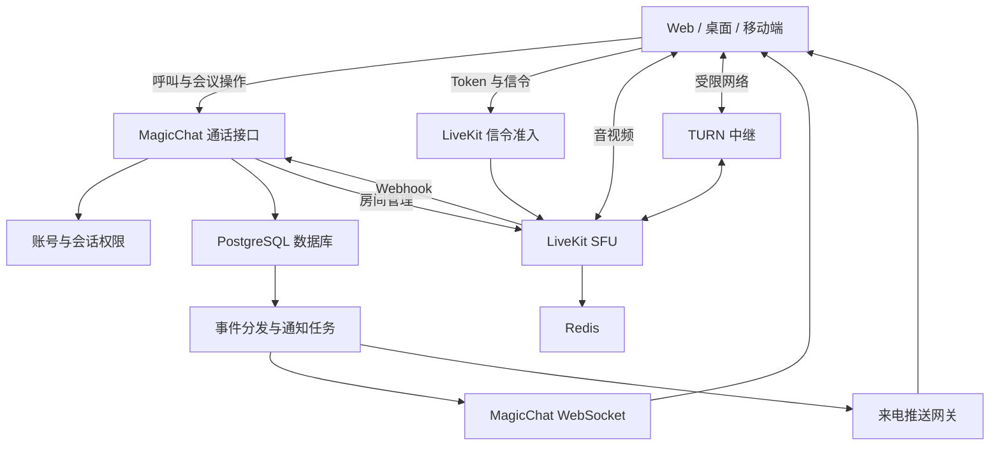

# MagicChat 基于 LiveKit 的语音通话与音视频会议设计

## 1. 设计状态与代码基线

本文是语音通话、语音会议和视频会议的目标设计，供客户端、服务端和部署实现使用。文中接口、表结构及配置均为拟新增内容，容量和时延为待验证的验收目标。

代码基线为 MagicChat 上游 `main` 的 [`77a908fcceb6ad16b62893a4e4b1be32a6e72185`](https://github.com/chaitin/MagicChat/tree/77a908fcceb6ad16b62893a4e4b1be32a6e72185)，核对日期为 2026-11-26。后续实现从该基线建立功能分支，并在依赖升级时重新验证原生 SDK、信令路径和权限语义。

### 1.1 现有能力与接入边界

| 现有能力 | 设计中的用途与约束 |
| --- | --- |
| Go、Echo、GORM 服务端 | 实现通话状态机、会议权限、Token 签发及 LiveKit 适配 |
| 用户私聊、群聊、应用会话、话题讨论 | 通话关联 Conversation；首期开放用户私聊和群聊 |
| WebSocket 事件协议 | 扩展 RTC 事件，客户端重连后通过快照恢复 |
| Web React、Electron React | 接入 LiveKit JS SDK，分别适配浏览器与桌面系统能力 |
| Expo 57、React Native 0.86 移动端 | 接入 LiveKit React Native SDK，先验证原生依赖兼容性 |
| 移动设备授权、推送任务及网关 | 扩展来电事件、短 TTL、系统接听和取消通知 |
| 消息历史、会话列表 | 展示进行中的会议、邀请卡片及通话结果 |

影响实现的代码事实：

- [WebSocket 连接池](https://github.com/chaitin/MagicChat/blob/77a908fcceb6ad16b62893a4e4b1be32a6e72185/server/internal/realtime/pool.go#L30)使用进程内用户连接映射；多业务实例需要补充跨实例分发。
- [实时协议](https://github.com/chaitin/MagicChat/blob/77a908fcceb6ad16b62893a4e4b1be32a6e72185/server/internal/realtime/protocol.go)已有事件封装和 Cursor 字段，但不能据此假设普通客户端已有持久化事件重放。
- [推送网关](https://github.com/chaitin/MagicChat/blob/77a908fcceb6ad16b62893a4e4b1be32a6e72185/push-gateway/internal/gateway/service.go#L376)当前只接受 `message.created`；[APNs 实现](https://github.com/chaitin/MagicChat/blob/77a908fcceb6ad16b62893a4e4b1be32a6e72185/push-gateway/internal/provider/apns/apns.go#L146)使用普通 `alert` 推送。
- [会话访问上下文](https://github.com/chaitin/MagicChat/blob/77a908fcceb6ad16b62893a4e4b1be32a6e72185/server/internal/application/conversationaccess/context.go)已处理父会话成员关系及话题来源消息可见性；[私聊策略](https://github.com/chaitin/MagicChat/blob/77a908fcceb6ad16b62893a4e4b1be32a6e72185/server/internal/application/directmessagepolicy/policy.go)已有拉黑和好友模式检查，应复用这些规则。

## 2. 产品范围与默认策略

| 场景 | 入口 | 核心行为 | 首期人数目标 |
| --- | --- | --- | --- |
| 一对一语音通话 | 用户私聊 | 振铃、接听、拒绝、取消、忙线、未接、通话记录 | 2 人 |
| 语音会议 | 群聊 | 群内持续入口、主动加入、指定邀请、主持人管理 | 50 人 |
| 视频会议 | 群聊 | 摄像头、宫格、发言人视图、语音参会、桌面共享 | 16 人 |

人数为产品和验收初始上限，实际发布上限取服务端容量、客户端解码能力和测试结果的交集。视频会议移动端默认最多显示 4 路、桌面端最多 9 路，按可见区域订阅。

默认规则：

- 同一服务端账号同一时间只参加一个通话或会议。指定邀请可提示忙线，群会议仍可在离开当前通话后加入。
- 一个账号在一次通话或会议中只保留一个有效媒体设备，切换设备必须经过显式接管。
- 群会议创建后在群内显示入口；仅向明确邀请的成员振铃。
- 创建时选择语音或视频会议，会议存续期间保持该模式；视频模式最多允许 16 名真人参会，摄像头关闭的成员也计入人数。人数规则见第 6.1 节。
- 首期屏幕共享覆盖 Web 和 Electron；移动屏幕共享在原生录屏扩展完成后开放。
- 应用会话和 AI 参会后续接入；话题会议需同时检查父会话成员身份、来源消息可见性及话题状态。
- 录制和转写作为可选扩展，须显式开启并向参会者展示状态。

## 3. 总体架构与职责

MagicChat 是业务状态和授权的事实来源；LiveKit 是房间、媒体轨道及实时媒体连接的事实来源。MagicChat 不转发音视频数据。



两条连接独立运行：MagicChat WebSocket 短暂断开时，已建立的媒体通话可以继续；LiveKit 重连时，聊天仍然可用。客户端分别展示业务同步状态和媒体连接状态，禁止通过聊天在线状态直接判断用户是否仍在通话。

### 3.1 服务端模块

| 拟新增或扩展位置 | 职责 |
| --- | --- |
| `server/internal/application/rtc/` | 状态机、权限、邀请、设备占用、超时及补偿 |
| `server/internal/api/http/client/rtc.go` | 客户端请求、响应及参数校验 |
| `server/internal/httpserver/rtc_*.go` | 路由、依赖装配、事件投递和 Webhook 接入 |
| `server/internal/infrastructure/livekit/` | RoomService、Token、成员管理适配 |
| `server/internal/realtime/protocol.go` | RTC 事件常量与载荷 |
| `server/internal/application/mobilepush/` | 来电通知策略和任务 |
| `push-gateway/` | 来电协议、VoIP Token、平台投递及取消通知 |
| `server/internal/store/`、`server/migrations/` | 数据模型、约束及迁移 |

服务端使用 `github.com/livekit/server-sdk-go/v2`，版本在 PoC 后锁定。业务层通过 `RoomProvider`、`NotificationPort`、`EventPublisher` 等接口访问外部能力，便于模拟故障。

## 4. 数据模型与一致性

生产环境以 PostgreSQL 为设计目标。持久化数据应区分业务会话、用户参会资格和设备连接。

| 表 | 核心字段与用途 |
| --- | --- |
| `rtc_sessions` | `id`、`conversation_id`、`kind`、创建时确定的 `media_mode`、`created_by`、业务 `status`、`version`、起止时间、阶段截止及结束原因 |
| `rtc_rooms` | `id`、唯一的 `session_id`、随机 `room_name`、`room_sid`、房间状态、独立的 `cleanup_status` 及清理重试信息 |
| `rtc_participants` | 会话、用户、角色、加入资格、禁止重入标记、`microphone_blocked`、`audio_blocked`、单调递增的 `permission_version` |
| `rtc_connections` | 参与者、登录会话、设备标识、随机 LiveKit identity、`room_id`、连接代次、Participant SID、连接状态、独立的 `transport_status` 与 `media_authorization_status`、`allocated_at`、绝对 `join_deadline`、固定媒体复核截止、`recovery_started_at / recovery_deadline`、加密的短效凭据及过期时间、准入尝试、已应用权限版本及入退会时间 |
| `rtc_invitations` | 会话、邀请人、被邀请人、状态、过期时间、接听设备、版本 |
| `rtc_user_leases` | 用户当前通话、持有连接、`reserved / active / quarantined` 状态、租约截止时间及 fencing token |
| `rtc_idempotency` | 认证请求方、操作、幂等键、创建请求键内时间、请求摘要、稳定业务结果／连接引用、处理状态及保留期限 |
| `rtc_outbox` | 事件或外部任务、固定房间及连接目标、期望权限版本、操作序号、幂等键、执行结果确定性、重试状态、下一次执行时间 |
| `rtc_webhook_inbox` | Webhook ID、房间及连接标识、载荷、接收时间、处理状态 |

关键约束：

- `rtc_user_leases.user_id` 唯一；抢占通话和设备接管使用数据库条件更新或行锁。
- 每个群聊首期只允许一个业务状态未到 `ended` 的会议，通过 PostgreSQL 部分唯一索引保证；已经结束但仍待清理的房间不占群会议槽位。
- 每个业务会话绑定一个房间记录，`session_id` 和 `room_name` 分别唯一；房间名永久不复用，清理任务只操作绑定的房间记录及名称。
- 同一邀请只能有一个成功接听连接；同一次会话中同一用户只能有一个当前连接代次。
- 同一请求方和操作范围内，幂等键唯一，并记录请求摘要；重复键但载荷不同返回冲突。
- 同一业务事件和投递目标的 Outbox 任务唯一；Webhook ID 唯一。
- 计时和截止判断使用服务端 UTC 时间，客户端倒计时用于展示。

业务状态变更与 Outbox 写入在同一事务提交。建房、成员权限更新、踢人、推送和实时投递在事务外执行，使用幂等任务重试。任务领取采用有期限的所有权和 fencing token，数据库拒绝过期 worker 回写；LiveKit 不识别该 token，外部操作顺序按第 4.1 节控制。

建房流程为：在事务内创建 `preparing` 业务、`rtc_rooms` 记录及任务，调用 LiveKit，成功后保存房间 SID 和配置摘要，再推进业务状态并发邀请。调用超时后先按绑定的随机房间名查询，再决定重试；准备截止到达后结束业务，并补偿清理迟到创建的房间。显式建房使用第 11.2 节的参数模板。

### 4.1 外部操作顺序与不确定结果

房间创建和删除使用房间级操作队列；同一 identity 的授权、降权和移除使用连接级操作队列。一个作用域内只允许一个结果可确定的执行链，任务显式绑定 `room_id`、连接代次、`permission_version` 和操作序号。房间关闭先禁止该房间的新授权，再排空或隔离在途操作。

权限 worker 每次执行前读取当前业务状态，跳过过期任务，按第 5.4 节状态授权表和第 6.2 节来源限制计算最新期望权限并发送完整设置；降低权限时显式设置禁止项。授予权限前再次检查业务阶段、邀请接听结果、绑定设备、成员资格、房间绑定和连接代次。完成后比较当前版本；若已变化，立即应用最新期望状态并查询验证。WebSocket 和推送只描述数据库已提交的业务状态，不能将外部请求成功等同于授权仍然有效。

超时或 worker 失联时标记 `outcome_unknown`。接管 worker 不得直接假定远端没有执行，也不得把仍可能迟到的授权请求与新授权并发发送。先尝试查询确认；由于查询不能证明旧请求不会随后执行，仍无法排除在途授权时，撤销并停用旧 identity，通过移除和持续对账清理。旧 identity 不复用，新连接只能在旧媒体退出被确认后激活。所有结果迟到回写只更新对应旧代次和清理记录。

对账按最新期望状态修复权限，清理所有业务已结束、身份已停用或代次失效的连接。跨系统不具备原子提交，撤销效果按第 8.1 节的生效模型和第 13.2 节指标验收。

### 4.2 业务结束与媒体清理

结束请求在事务内禁止该业务会话所有新准入和授权，使邀请进入终态，冻结结束时间和原因，写入媒体清理任务及结果消息任务。`ending` 仅用于业务收尾；任务可靠入库后即可进入 `ended`，独立的房间 `cleanup_status` 为 `pending / running / outcome_unknown / succeeded`。媒体清理失败不阻止发布业务终态或创建新的群会议。

群会议槽位在业务 `ended` 后释放。用户占用按以下规则释放：未发过入会许可且无在途准入的预留槽位可直接释放；已发过许可或有媒体连接的占用，需要确认对应成员／房间已移除，或旧媒体节点已被隔离后释放。仅挂断请求成功、租约时间到期或客户端自报退出都不足以证明旧媒体已停止。

远端结果不确定时，仅相关用户的占用转为 `quarantined`，客户端显示“上次连接正在清理”，允许继续聊天及查询状态，暂不激活新的媒体连接。每 3 秒重试确认，60 秒未恢复升级告警。用户租约状态与群会议槽位分开，避免一次异常阻止整个群继续创建会议。

此处选择单账号媒体互斥优先：控制面长期不可达时，不承诺该用户一定能在固定时间内重新参会。运维恢复需取得远端关闭证明，或先完成旧媒体节点网络／进程隔离，再通过受审计的恢复操作释放占用。禁止仅修改数据库强行释放仍可能有效的媒体连接。

清理持续重试并保留目标房间标识及连接代次，延迟清理不得删除其他业务会话的房间；业务终态、结束时间和结果消息均不因补偿恢复为活跃或重复生成。

### 4.3 入会席位的分配与到期回收

首次入会、设备接管或完整重连时，在分配／绑定席位的同一事务中按第 4.4 节计算并保存 `allocated_at`、`join_deadline` 及到期任务。完整重连先按第 5.5 节确定可继承的截止，再分配替代连接；活跃群会议中的新成员也执行席位到期规则。

设备权限在用户确认加入后、分配席位前请求。截止覆盖凭据领取、传输建立及首次媒体授权，同键重试和新信令尝试不延长。传输及当前权限就绪后完成入会，历史 `join_deadline` 保留作诊断依据，旧到期任务失效；已有有效 SID 的信令恢复使用当前恢复截止及单次尝试上限。

到期任务锁定连接，核对代次、当前阶段和对应截止；已完成阶段或被替代连接的任务跳过。未就绪连接到期后停用凭据及准入，置为 `left`，记录 `join_expired` 并写入清理任务。无准入和媒体操作的席位可直接释放，存在在途信令、媒体或不确定结果时按第 4.2 节确认清理或隔离后释放；对账同时补扫到期连接。

一对一首次入会到期以 `connection_failed` 结束通话；群会议只清理该成员连接，会议自身生命周期按第 6 节裁决。尚未申请入会的会议邀请不占媒体席位。Token 到期不能证明在途操作和媒体已停止。

### 4.4 截止时间与阶段适用表

本表统一定义计时起点、默认时长及组合规则，其他章节引用这些规则执行操作。截止使用服务端绝对时间，已完成阶段的历史截止不参与判断。服务端持久化计算结果并通过快照返回，客户端不自行重新起算。

| 计时对象 | 起算点与默认截止 | 完成与约束 |
| --- | --- | --- |
| 通话／会议准备 | 创建事务提交后 10 秒 | 房间就绪并提交下一业务状态后完成，迟到建房转清理 |
| 一对一振铃 | 进入 `ringing`、邀请可投递后 30 秒 | 接听、拒绝、取消或过期后完成 |
| 接听后首次连接 | 接听事务提交后 20 秒 | 双方媒体及权限就绪后完成，尚未调用 `join` 也受此截止约束 |
| 首次入会／接管／完整重连 | 分配事务提交后 20 秒 | `join_deadline` 取此值与适用的接听后首次连接、会议首次入会／空会、已有恢复截止的最早值；首次入会未完成时替换连接还须继承其原入会截止，媒体就绪后完成 |
| 单次信令准入 | 网关登记后最多 10 秒 | `attempt_deadline` 取此值与当前阶段截止的最早值；过期仅关闭该次尝试，不因信令中断直接结束健康媒体 |
| 媒体激活复核 | 传输就绪且业务允许激活时起最多 10 秒 | 复核截止取此值与当前入会及恢复截止的最早值，固定后重试不重置 |
| 已接通连接恢复 | 首次确认连接中断或首次受理该连接完整重连，两者先发生时起 30 秒 | 已有活动恢复截止即沿用；SDK 恢复、重复请求及替代连接共用该截止，到期后拒绝继续替换，完全恢复后才结束本次预算 |
| 会议首次入会等待 | 房间就绪并进入 `open` 后 5 分钟 | 首个成员媒体就绪后完成，再次尝试不重置 |
| 正常会议空会等待 | 活跃会议变为空会后 60 秒 | 仍有效的成员恢复按第 6 节处理，成员媒体就绪后取消 |

仅信令中断、媒体仍健康时，恢复尝试使用自身 10 秒上限，不另起媒体恢复预算。Token 有效期、用户租约及 worker 所有权均不替代业务截止。

## 5. 状态机与呼叫流程

### 5.1 状态定义

| 对象 | 状态 | 转换原则 |
| --- | --- | --- |
| 一对一通话 | `preparing → ringing → connecting → active → ending → ended` | 接听后才进入连接阶段；双方媒体连接建立后进入通话中 |
| 会议 | `preparing → open → active → ending → ended` | 房间准备后允许加入；首个成员媒体连接就绪且权限激活后开始会议 |
| 邀请 | `pending → accepted / rejected / cancelled / expired` | 终态不可逆；接听设备单独记录 |
| 设备连接 | `joining → connected → reconnecting → left` | `joining` 包含待复核的无媒体授权阶段；重连恢复可回到 `connected`，设备接管使用新连接代次 |
| 媒体房间 | `preparing → ready → draining → closed` | 业务终态与房间清理状态分别保存，确认房间丢失后结束该业务会话 |

准备失败、拒绝、取消或超时均可直接推进到 `ending`。生命周期与结束原因分开保存：`completed`、`rejected`、`cancelled`、`missed`、`busy`、`connection_failed`、`permission_revoked`、`service_unavailable`。

同一用户其他设备收到邀请更新后，根据接听连接展示 `answered_elsewhere`，该结果是设备展示状态，邀请本身仍为 `accepted`。

### 5.2 一对一语音通话

1. 主叫创建请求，校验账号、私聊成员、好友模式、拉黑关系和通话占用。按用户 ID 固定顺序锁定双方占用记录，避免互拨死锁。
2. 创建通话和被叫邀请，占用双方槽位；房间就绪后进入 `ringing`，两端展示呼叫状态，媒体连接从接听成功后开始建立。
3. 在线设备收到 WebSocket 来电事件，符合策略的设备收到系统来电推送。
4. 被叫接听时，以邀请状态、截止和版本执行原子更新，绑定唯一设备，进入 `connecting`，按第 4.4 节保存首次连接截止及到期任务。取消与接听由同一状态转换裁决。
5. 主叫发起设备和被叫接听设备调用 `join`，取得无媒体授权 Token，按第 5.4、8.1 节连接、复核及激活；其他被叫设备停止振铃。响应丢失时按第 7.3 节恢复业务结果及有效凭据。
6. 双方媒体连接及当前权限均就绪后进入 `active`，从此时开始计算通话时长。
7. 任意一方挂断均结束通话，按第 4.2 节发布终态、撤销准入、异步清理并生成一次结果消息。

双方同时互拨时，在锁内优先返回同一对用户的现有呼叫及角色，无法合并时返回明确冲突，不生成两个互相振铃的会话。

各阶段时限见第 4.4 节。首次连接失败记录为 `connection_failed`，已接通连接按第 5.5 节恢复。业务 WebSocket 断开本身不触发挂断。

本地挂断立即停止媒体采集并释放设备，以稳定幂等键提交结束请求，失败时重试。服务端通过媒体断开、对账及超时补偿，结果不确定时隔离清理。

### 5.3 多设备接管

设备切换需用户明确确认。服务端在事务内增加连接代次，撤销旧连接资格，再断开旧 identity，确认旧媒体连接关闭后才为新连接执行权限激活。准入网关只接受当前代次。远端清理不确定时进入隔离恢复流程，旧连接的迟到退出事件不得释放新连接的租约。

租约用于并发协调和故障恢复，其过期不单独代表媒体通话结束。服务端结合有效连接与 LiveKit 对账结果续租或按第 4.2 节清理；信息不确定时使用明确的 `quarantined` 状态和恢复流程。

### 5.4 业务阶段与媒体授权

以下为真人连接的服务端授权上限，发布权限还需与成员角色、会议模式、主持人限制及设备能力取交集。传输连接就绪和媒体授权就绪分别保存，收到 `participant_joined` 不等于可以授予媒体权限。

| 业务阶段 | 可建立的连接 | 发布／订阅上限 |
| --- | --- | --- |
| 一对一 `preparing` | 房间尚未就绪，不能签发入会许可 | 全部禁止 |
| 一对一 `ringing` | 双方保持呼叫／来电界面，入会接口拒绝媒体连接申请 | 全部禁止 |
| 一对一 `connecting` | 主叫设备及邀请事务确定的唯一接听设备 | 复核后允许语音发布和订阅；麦克风采集还需本端权限和用户接听操作 |
| 一对一 `active` | 当前有效设备，恢复时遵循代次和截止时间 | 保持当前有效媒体策略；新传输必须再次复核 |
| 会议 `open / active` | 已明确请求加入、取得席位且有参会资格的设备 | 复核后按会议期望模式及成员限制授权；指定邀请本身不等于加入 |
| 任意 `ending / ended` | 拒绝新连接，已有连接执行撤销 | 全部禁止 |

初始 Token 始终无媒体权限。接听、取消、拒绝、超时及成员撤销在事务内裁决并增加相应版本。一对一激活任务必须再次确认邀请为 `accepted`、绑定设备未变且业务为 `connecting / active`；会议激活则核对当前席位及参会资格。条件不满足时保持无权限并按当前状态清理。

### 5.5 连接恢复与房间故障

SDK 先恢复当前房间及原 SID；需要完整重连时，客户端停止旧 Room，通过业务接口申请替代连接。服务端在锁定当前连接、校验业务资格和预期代次的事务内确定恢复计时：已有活动 `recovery_started_at / recovery_deadline` 时直接沿用；曾完成媒体就绪且尚无活动恢复时，按第 4.4 节创建并持久化。完整重连请求先于 Webhook 或对账检测到达时，该请求本身触发此事务，不能等待后续断线通知。

确定截止后，事务内停用旧连接新增准入并写入撤销／清理任务。旧媒体退出得到确认后才分配并激活替代连接，将原恢复起点及绝对截止原样复制过去；清理等待也计入原预算。尚未完成首次入会的连接替换仅继承原入会截止，不创建已接通恢复预算。截止已到时按原到期规则结束连接或通话，不再分配替代连接。

重试、worker 接管及连接代次替换不重置同一次恢复预算。到期任务携带连接 ID、代次及预期截止，锁内核对后执行；已恢复、被替代或截止已变化的旧任务跳过，为替代连接登记继承截止的任务。一对一须双方媒体及权限就绪后完成恢复，群会议按成员分别完成，不取消其他成员任务。恢复完成时在事务内更新连接状态、清空其活动恢复截止并记录结果，使旧任务失效。

单个会议成员恢复到期只结束其连接；一对一任意一方恢复到期结束通话。用户主动离开、结束及权限撤销立即生效。完全恢复后的新中断才创建下一次预算；首次入会继续使用原入会截止，不通过恢复续期。

房间查询失败保持不确定，在现有预算内重试并告警；确认房间不存在或媒体节点已停止时，将相关业务结束为 `service_unavailable`。控制面长期不可达时按第 4.2 节清理／隔离占用，媒体状态以可核验结果为准。新的通话或会议由用户重新发起，使用新业务 ID 和房间名。

快照返回成员实际生效的恢复截止，客户端重试不超过该值；媒体健康的信令中断按第 4.4 节处理。

## 6. 会议权限与生命周期

会议创建者默认主持人，可指定联席主持人。群管理员的会议管理能力来自当前群权限，不能通过客户端提交角色获得。

| 操作 | 普通成员 | 主持人、联席主持人或授权管理员 |
| --- | --- | --- |
| 加入未锁定会议 | 有群成员资格时可以 | 可以 |
| 控制自己的麦克风和摄像头 | 可以，受媒体策略限制 | 可以 |
| 邀请群内成员 | 按会议设置 | 可以 |
| 举手、申请发言 | 可以 | 可以 |
| 禁止成员发布音频 | — | 可以 |
| 移除成员、锁定、结束会议 | — | 可以 |
| 请求成员开启麦克风 | — | 可以，对方确认后开启 |

主持人限制在服务端持久化并通过 LiveKit 更新发布权限，防止客户端自行恢复；“关闭麦克风”和“禁止全部音频发布”按第 6.2 节分别计算。恢复权限后仍由用户自行决定是否采集和发布，不远程开启麦克风。

主持人确认离开或其恢复截止到期后，优先移交联席主持人，其次选择具备管理资格的在会成员；无人接任时会议继续。正常空会等待 60 秒；仍有成员恢复时，结束截止取空会截止与这些成员仍有效恢复截止的最晚值，并持久化。尚无人成功加入的 `open` 会议默认 5 分钟过期。LiveKit 房间超时采用第 11.2 节值，主持人主动结束按第 4.2 节收尾。

锁定会议禁止新参与者加入，仍允许已有有效席位在该成员的恢复截止内恢复；恢复时新 identity 不被当作新增参会者，但必须核对原席位和设备。被移除成员不得通过旧邀请重新加入，需要主持人显式恢复资格。

群成员退出或被移除、账号禁用、群解散时，先提交资格撤销，再按第 8.1 节清理相关连接；角色变更重新计算管理权限。

会中举手、角色、锁定和媒体策略通过 MagicChat 保存。LiveKit DataChannel 首期关闭客户端发布权限；后续临时互动不得作为权限和持久业务状态的唯一来源。

### 6.1 固定媒体模式与人数

`media_mode=audio / video` 在创建事务中确定并保持到结束。语音模式最多 50 人，视频模式最多 16 人，摄像头关闭的成员也计数；真人连接、待入会席位和恢复保留席位合并计算。设备接管和完整重连沿用原席位，不重复占额。

同一会话锁内校验和分配最后席位，数据库约束防止并发超员。LiveKit `max_participants` 使用房间模板的物理上限，业务层执行会议模式的人数限制，服务连接使用独立配额。发布来源由固定模式、角色及成员限制计算，摄像头／共享开关不改变会议模式。

### 6.2 音频限制与轨道来源

界面与接口区分两类操作，持久化为独立限制并增加 `permission_version`：

| 限制 | 禁止来源 | 可以保留的来源 |
| --- | --- | --- |
| 关闭麦克风 `microphone_blocked` | `microphone` | 会议允许的 `camera`、`screen_share` 和显式获准的 `screen_share_audio` |
| 禁止全部音频 `audio_blocked` | `microphone`、`screen_share_audio` | 会议允许的 `camera` 和 `screen_share` 视频 |

主持人默认的“禁止发言／禁止音频”使用 `audio_blocked`，避免通过屏幕音频继续发声。仅关闭麦克风时，界面明确提示共享音频可继续。两类限制按集合叠加，解除其中一项不能绕过另一项；语音模式本身不允许任何屏幕或摄像头来源。

服务端从完整的允许来源集合中扣除禁止来源，并调用 LiveKit 更新权限，确认已发布的被禁止轨道被取消发布。当剩余发布来源为空时设置 `canPublish=false`；保留视频来源时使用明确的 `canPublishSources` 列表。限制作用于发布来源而非判断音频内容，恢复和设备接管都复用同一计算函数。

## 7. 客户端接口、事件与消息

以下均为现有客户端 API 前缀下的拟新增相对路径。请求身份取自认证上下文，不信任载荷中的用户 ID 或设备归属。

| 接口 | 用途 |
| --- | --- |
| `POST /rtc/sessions` | 发起通话或会议 |
| `GET /rtc/sessions/active` | 获取当前用户呼叫、邀请、占用和可见会议入口，支持 Conversation 筛选和分页 |
| `GET /rtc/sessions/{id}` | 获取会话快照和当前版本 |
| `POST /rtc/sessions/{id}/invitations` | 邀请指定成员 |
| `POST /rtc/invitations/{id}/accept` | 接听并确定唯一设备 |
| `POST /rtc/invitations/{id}/reject` | 拒绝邀请 |
| `POST /rtc/sessions/{id}/join` | 以 `intent=initial / rejoin` 校验资格、分配连接并按当前状态返回凭据 |
| `POST /rtc/sessions/{id}/takeover` | 显式接管设备 |
| `POST /rtc/sessions/{id}/leave` | 离开会议；一对一通话等同挂断 |
| `POST /rtc/sessions/{id}/end` | 挂断一对一通话或结束会议 |
| `PATCH /rtc/sessions/{id}/participants/{userID}` | 修改角色、发言权限或参会资格 |
| `PATCH /rtc/sessions/{id}` | 锁定及会议设置，创建时确定的媒体模式为只读字段 |
| `GET /rtc/preferences`、`PATCH /rtc/preferences` | 呼叫接收范围、来电免打扰和设备振铃偏好 |
| `POST /rtc/livekit/webhook` | 服务端接收 LiveKit Webhook，使用独立签名校验 |

写操作使用 `Idempotency-Key`；创建通话／会议的键必须是包含创建时间的 UUIDv7，按第 7.3 节限制新请求年龄。需要竞争控制的修改同时携带 `expected_version`，重新入会携带快照中的房间 ID 和连接预期代次。快照返回当前用户允许的操作，客户端只据此显示入口，服务端仍逐次鉴权。幂等保存稳定业务结果，凭据恢复遵循第 7.3 节。

入会响应包含 `session_id`、`version`、`room_id`、`connection_id`、连接 `generation`、`permission_version`、`allocated_at`、`join_deadline`、`livekit_url`、`credential_status`、适用时的 `token / expires_at` 及 `media_policy`。响应和快照返回第 7.4 节的 `connection_phase / phase_deadline` 及成员恢复截止，已完成阶段的入会截止只作历史值。

`credential_status=issued / reuse_connected / unavailable` 区分有效入会凭据、复用已有 Room 和需要刷新业务状态。Token 响应禁用缓存，代理与日志屏蔽 Token。快照返回业务状态、成员传输及授权状态、用户占用及当前设备的 `join_available`，客户端依据当前资格和截止操作。

### 7.1 实时事件

扩展现有 Envelope，事件包括：

```text
rtc.invitation.created
rtc.invitation.updated
rtc.session.updated
rtc.participant.updated
rtc.connection.updated
rtc.session.ended
rtc.sync.required
```

业务事件使用 Envelope `id` 作为稳定事件 ID，载荷包含 `session_id`、会话单调递增的 `version` 和 `occurred_at`；同一业务变更可携带完整快照，避免多个相同版本增量相互覆盖。个人邀请事件只投递给相关用户，群会议事件按当前可见性过滤。`rtc.sync.required` 是连接级控制事件，携带原因和同步范围，不推进业务版本。

Outbox 重试沿用同一事件 ID。各业务实例订阅 Redis Pub/Sub，将事件投递给本实例连接；Pub/Sub 是通知渠道，持久化状态仍在 PostgreSQL。客户端按 ID 去重，旧版本不得覆盖新状态。

收到 `system.ready`、`rtc.sync.required`、版本跳跃、通知点击、从后台恢复、LiveKit 断开或会中操作冲突时重新拉取快照。每个业务实例在 Redis 订阅中断时标记同步不确定，订阅恢复后向其全部在线客户端发送 `rtc.sync.required`；不能仅依赖客户端 WebSocket 重连。

即使没有后续事件，客户端也执行有界校验：有当前通话或待接邀请时每 10 秒刷新对应快照；当前可见群会议入口每 30 秒批量校验，并在入口进入可见区域时立即刷新。周期加入不超过 20% 的抖动，同一登录目标合并请求，支持 ETag／版本返回和分页。后台受系统调度限制时暂停轮询，依靠本地来电截止时间和恢复后的立即同步。RTC 首期通过通知加周期快照收敛，不依赖客户端事件全量重放。

### 7.2 会话消息

会话记录使用现有 `text` 消息结构，`content` 和 `summary` 提供完整可读的发起人、会议类型、时间和结果；在消息体中增加服务端生成的可选 `rtc` 扩展，包含业务会话 ID、消息用途和版本。示例：

```json
{
  "type": "text",
  "content": "张三发起了语音会议，请在支持通话的客户端中加入。",
  "rtc": { "session_id": "<uuid>", "purpose": "meeting_started", "version": 1 }
}
```

只有服务端可信消息可以携带该扩展，用户发送接口不得接受客户端伪造的 `rtc` 字段。新客户端保留扩展并增强为可点击卡片；基线客户端忽略额外字段，沿用现有文本渲染。消息不含入会 Token，卡片点击后重新获取业务状态及权限。群内可见性和通话记录访问使用现有会话权限。

开始和结束消息使用确定的业务幂等键。状态更新复用现有消息更新和同步机制；能力接口控制新客户端是否展示通话入口。来电通知走独立事件策略，服务端生成的 RTC 文本记录须跳过普通消息推送，避免重复提醒。灰度前用未升级的 Web、桌面和移动端验证相同消息可以显示文本，不能把未知消息类型的默认占位视为兼容通过。

### 7.3 业务幂等与凭据恢复

幂等键的唯一范围为认证账号、登录会话、设备及操作；请求摘要用于校验同键载荷一致。稳定业务结果的重放保证窗口至少 24 小时，从首次受理时间起算。相同键和载荷重试不重复创建会话、接受邀请、分配席位或增加防骚扰计数；不同载荷返回 `idempotency_conflict`。处于处理中或关联未清理资源的记录按第 11.4 节继续保留。

`POST /rtc/sessions` 使用 UUIDv7 作为 `Idempotency-Key`，该键内时间在同一次用户发起操作中固定。服务端先认证、解析键并查已有记录：命中则校验摘要并在当前权限下恢复既有结果；未命中才检查键内时间，超过服务端当前时间前 5 分钟或晚于当前时间 30 秒即返回 `request_expired / invalid_request_time`，不占用账号、不建房、不发推送。新受理的年龄检查与幂等占位写入在业务事务内执行，并发同键由唯一约束裁决。

因此，即使原通话早已结束、24 小时幂等结果已被清理，旧创建键的时间也已超出新受理窗口，必须被拒绝。客户端自动重试保留原键，不能通过更新时间或换键把延迟请求变成新呼叫；超窗后提示用户确认，再以新的用户操作生成新键。客户端使用服务器返回的时间偏差校正 UUIDv7 时间，键内时间一经确定就不再修改。该时间只用于新请求年龄校验，业务计时仍使用服务端时间。

其他写操作绑定明确的会话、邀请或连接对象，幂等结果过期后仍逐次检查对象终态、截止及代次，不能复活已结束业务；如需在保证窗口外重新执行，必须显式创建仍获准的新业务操作。数据清理不得删除阻止旧操作再次生效所需的终态依据。

每次重试重新认证，核对业务资格、房间绑定、连接代次及适用截止。`accept` 幂等结果只标识已接听邀请及唯一设备，凭据由 `join` 领取；业务幂等记录保存连接引用。

每个连接代次签发一份初始无媒体授权 Token，过期时间不晚于 `join_deadline`。为恢复响应丢失的请求，用应用密钥加密暂存 Token 到连接记录，保存密钥标识、摘要和固定过期时间。明文只存在于签发／响应的短暂内存中；加密密钥通过部署密钥管理注入，解密兼容窗口覆盖有效凭据。签发、保存及幂等分配结果在同一事务完成，失败时不返回凭据。

| 当前结果 | 同键重试行为 |
| --- | --- |
| 传输未建立，凭据有效且资格、设备及房间绑定未变 | 解密返回原 Token 和原截止，复用连接，不重复分配席位或计数 |
| 原准入仍在途 | 保留尝试，返回同一有效凭据及状态，客户端复用正在进行的 Room 连接操作 |
| 传输已建立且有效 | 返回 `reuse_connected` 与快照，客户端复用已有 Room |
| 操作处理中或旧连接清理未确认 | 返回 `202` 和稳定操作引用，以同一键查询，不并行创建连接 |
| 已结束、资格撤销、连接被替代或当前截止已到 | 返回当前状态及 `session_ended / forbidden / connection_superseded / join_expired / recovery_expired`，不返回旧凭据 |
| 有效凭据无法解密 | 返回 `credential_unavailable`，告警并停用该连接新增准入，客户端查询后按当前资格处理 |

传输建立、凭据到期或资格失效后删除加密 Token，保留身份、摘要及撤销状态供对账。在连接锁内确保一个连接代次只登记一个有效首次准入尝试；有效初始凭据对应的原尝试仍在途时，重复首次连接按第 8.4 节返回临时失败，保留原尝试及截止，不新增或替换它。传输建立后拒绝初始凭据再次新建连接，已有 SID 的恢复按第 8.4 节处理。

SDK 在在线连接中刷新的 Token 用于恢复原 SID，仍须校验当前资格与权限。初始 Token 到期不影响已经就绪的在线连接，尚未完成入会的连接按原入会截止清理。客户端确需再次连接时先查询快照，以新键、`intent=rejoin` 和预期连接代次申请，服务端按第 5.5 节确定恢复起点、继承截止并清理旧连接，再分配替代连接及凭据。到期后不能复活旧连接或已结束通话；群成员再次加入需在旧占用清理后作为新的显式入会操作裁决。

旧 `join` 键只恢复原连接结果，替代连接响应丢失时使用该次新键恢复。客户端按业务版本、连接 ID 和代次忽略迟到响应。重试不延长截止，清理不确定时继续隔离占用。

### 7.4 连接阶段与截止响应

`connection_phase` 由服务端按当前设备连接及恢复截止计算，接口、快照及事件采用同一规则。设备连接状态、传输及媒体授权分别保存，阶段和截止从同一版本快照生成。

| `connection_phase` | 设备连接状态及条件 | `phase_deadline` |
| --- | --- | --- |
| `joining` | `joining`，传输未就绪且无已有通话恢复 | 当前 `join_deadline`，已受业务阶段截止收紧 |
| `activating` | `joining`，传输就绪、首次授权未完成 | 按第 4.4 节保存的固定复核截止 |
| `connected` | `connected`，传输及本次入会／恢复授权已就绪 | `null` |
| `recovering` | 原连接 `reconnecting` 或替代连接 `joining / connected`，已有恢复未完成 | 按第 4.4 节计算的当前有效截止，沿用原预算并受尚未完成的入会／复核阶段约束 |
| `left` | `left`，业务结束、资格撤销、被替代或退出 | `null` |

失效连接优先返回 `left`，恢复未完成时返回 `recovering`，其余按实际入会阶段判定。会中普通权限更新进度单独返回，不重开首次激活计时。

无当前设备连接时返回 `connection_id=null`、`connection_phase=null`、`phase_deadline=null`；邀请截止及接听后的会话首次连接截止另行返回。非空截止使用 UTC RFC3339，空值仅表示该连接阶段没有活动截止，加入资格仍由服务端裁决。仅信令中断且媒体健康时保持 `connected`，单次尝试上限由网关独立执行。

阶段变化增加业务版本，使旧阶段任务失效并为仍有效截止登记当前任务。客户端按版本和连接代次整体应用阶段及截止，到期时停止尝试并刷新状态，本地倒计时不发布业务终态。

## 8. 身份、Token 与权限撤销

入会必须检查登录会话、账号状态、Conversation 访问权、邀请或会议资格、会议锁定、禁止重入标记、人数及设备占用。私聊呼叫复用好友模式和拉黑策略；正在通话时相关权限变化也需要触发撤销。

- 房间名和 Participant identity 使用随机、不含个人信息的标识，映射保存在 MagicChat。
- identity 绑定服务端确认的用户、登录会话、设备连接及代次，客户端不能自行指定。
- 初次入会及完整重连通过业务接口取得截止不晚于 `join_deadline` 的短效 Token，仅允许进入该会话绑定的房间，初始设置 `canSubscribe=false`、`canPublish=false`、`canPublishData=false`；入会后按第 5.4 节复核并激活。SDK 刷新 Token 不改变业务截止和准入资格。
- 激活时明确设置 `canSubscribe`、`canPublish`、`canPublishSources`、`canPublishData`；语音场景仅开放麦克风，视频和屏幕按策略授权。无任何发布来源时设置 `canPublish=false`，不得用空来源列表表达禁止全部发布。
- 客户端不获得 `roomAdmin`、录制和其他管理授权；所有管理操作经过 MagicChat。
- API Secret 保存在服务端密钥管理中，房间名、日志和 Token 不携带邮箱、手机号等个人信息。

### 8.1 自建 LiveKit 的准入网关

自建 LiveKit 的成员移除和权限更新不会自动使旧 Token 失效，在线连接还会收到 LiveKit 刷新的 Token。仅设置短 TTL 无法保证立即禁止旧 Token 重入。

授权分为准入、入会复核、媒体激活和持续撤销四步：

1. 所有公网信令连接与重连经过准入网关，关闭 LiveKit 信令服务的公网旁路，媒体端口独立直达。网关校验 Token，并从权威状态检查账号、登录会话、业务状态、房间绑定、连接代次及资格。首次入会与完整重连仅接受摘要匹配当前连接的无媒体授权初始 Token。
2. 网关为在途信令登记类型、当前授权版本及按第 4.4 节计算的 `attempt_deadline`，按第 7.3、8.4 节处理重复首次准入。转发前再次核对资格、绑定及当前截止，关闭失效尝试。
3. 收到媒体连接建立通知后，重新核对业务、账号、绑定设备、房间、连接代次和准入尝试，通过第 4.1 节队列应用当前期望权限。Webhook 缺失时按第 8.2 节匹配身份及 `ParticipantInfo.state=ACTIVE` 后确认传输就绪。业务允许激活时，按第 4.4 节登记固定复核截止；到期未通过则清理，不能默认放行。
4. 撤销事务增加 `permission_version`，使在途准入失效，禁止新的 Token 和授权任务。随后关闭可追踪的在途信令，并优先执行降权或移除。每个 `participant_joined` 都先做资格复核；出现失效身份立即清理，不能仅将其写为在线。对活跃、在途及撤销待完成的连接每 3 秒滚动对账，覆盖先移除、后完成入会的竞态。
5. 已有连接的信令恢复重新检查资格及当前权限，仅同一绑定房间、identity 和有效 SID 的恢复可使用 SDK 刷新的 Token。过期权限、失效 SID 或需业务完整重连时按第 8.4 节返回标准结果。完整重连保留席位，先确认旧连接关闭再建立新连接代次，不并行激活两个 identity。
6. 准入和激活检查使用权威状态，禁止长期允许缓存；无法可靠确认时拒绝新的连接或激活，已有连接按撤销与清理队列处理。LiveKit 管理 API 仅供内网可信服务访问，客户端 Token 不能用作管理凭据。

业务撤销在数据库提交时生效；跨系统的媒体停止采用有界收敛目标，健康条件下见第 13.2 节。权限更新本身仍存在在途请求，不能承诺撤销提交瞬间所有媒体都已停止。超过撤销目标立即告警，并冻结相关用户／房间的新激活；控制面不可达时按第 4.2 节隔离，不能把重试中报告为已完成撤销。

PoC 必须验证所选 SDK 在无发布、无订阅权限下建立连接并触发复核的路径，以及初次连接、信令恢复、完整重连和刷新 Token 的处理；按第 8.4 节锁定每端错误与取消适配。用可暂停的测试屏障覆盖“接听与取消竞争”“激活前取消”“网关放行后撤销”“成员建立前移除”“旧授权请求迟到”，并以实际媒体收发验证权限效果。不能支持该流程的版本不得开启生产 RTC。

若部署要求撤销与媒体准入之间完全没有授权窗口，须额外实现 LiveKit 内部、覆盖权限激活的同步授权与连接隔离机制，并独立验证故障语义；本方案的网关和异步补偿提供上述有界收敛，不将其等同于跨系统原子撤销。

### 8.2 Webhook 与对账

Webhook 通过官方 Go 校验器验证 `Authorization` 和原始请求体摘要，接受 `application/webhook+json`，限制体积并在可靠入库后返回成功。后台按事件 ID 去重，使用房间 SID、Participant SID、连接代次及当前业务状态处理事件。

LiveKit 的 `participant_joined` 表示媒体连接建立，仍需完成业务复核和权限激活才能计入媒体就绪；客户端报告只用于加速显示，不能单独确认服务端计费或通话结果。旧连接的退出、旧房间的结束事件只更新旧代次的记录和清理结果。

成员查询补偿使用以下状态判定，PoC 按锁定版本验证这些协议语义：

| `ParticipantInfo.state` | 含义 | 业务处理 |
| --- | --- | --- |
| `JOINING` | 信令已连接，尚未完成 offer 阶段 | 保持传输未就绪，沿用当前入会／恢复截止 |
| `JOINED` | 服务端已收到客户端 offer，ICE 尚未确认建立 | 保持传输未就绪，不激活媒体、不完成入会或恢复 |
| `ACTIVE` | ICE 连接已建立 | 身份及当前阶段复核通过后可确认传输就绪，再按第 5.4 节执行媒体授权 |
| `DISCONNECTED` 或未知状态 | 已断开，或锁定版本尚未适配的状态 | 不作为传输就绪证据；按当前连接状态继续恢复、清理或到期处理，未知状态告警 |

查询结果须匹配当前 `room_id` 绑定的房间 SID、连接代次和 identity；已有 Participant SID 时必须一致。首次绑定 SID 时，在连接锁内核对当前有效准入尝试及查询得到的身份，再保存 SID。结果归并前重读当前资格、版本、阶段及截止，旧代次或已撤销连接的结果只用于对应清理，不能推进当前连接。成员记录存在、人数非零或查询 RPC 成功均不能单独证明传输就绪。

仅 `ACTIVE` 也不等于业务媒体已就绪：连接仍需确认业务允许激活及当前期望权限已应用。一对一通话开始计时、会议首次入会成功以及恢复完成均沿用各自的媒体就绪条件。成员停留在 `JOINING / JOINED` 时继续有界对账，达到当前阶段截止后按第 4.3、5.5 节处理；查询失败保持不确定状态，不将失败结果当作已断开或已就绪。

Webhook 不保证必达。对 `connecting`、`active`、在途准入、待撤销连接和待清理房间每 3 秒调度一次滚动对账，通过房间及成员查询补全状态；查询合并到房间级，防止逐成员调用放大。提供商暂时不可达记录结果不确定、使用带抖动退避并告警，不能将请求失败直接解释为房间不存在。未进入 RTC 的普通会话不参与轮询。

#### 8.2.1 对账调度与控制面预算

按 LiveKit 部署和 `room_id` 合并对账，同一房间最多一个有效在途快照查询，结果供入会复核、成员差异及清理确认使用。共享数据库以 `next_run_at` 索引、有界批次及有期限的所有权调度，多实例不能重复领取同一任务；迟到结果按第 4.1 节复核。

健康对账目标周期为 3 秒，以房间哈希错开执行。每实例配置固定 `RTC_RECONCILE_WORKERS`，只读 RPC 默认 1 秒超时，并受任务剩余有效时间收紧。最大副本数乘每实例 worker 数构成部署并发上限，发布和扩容前按第 11.3 节验证容量，以部署副本数和 worker 配置控制负载。

撤销、移除、入会激活及恢复任务优先于稳定巡检，同级按截止及到期时间执行。事件触发的终止与权限撤销立即入队，不等巡检，数据库到期转换独立执行。稳定房间按到期时间轮转并合并重复触发。

失败采用带抖动的指数退避，初始 1 秒、间隔最多 30 秒；入会及恢复受原截止约束，清理在业务结束后持续执行。积压时降低新建和入会受理量，维持挂断、撤销及清理，不延长截止或使用过期授权；worker 重启后按原到期时间和最近成功时间恢复调度。

健康条件下排队时延目标 p95 ≤ 500 ms；排队超过 1 秒持续 30 秒，或应巡检房间超过 6 秒没有成功对账时告警。实际负载下须同时达到第 13.2 节撤销和清理指标，控制面不足时降低发布房间／席位上限。

### 8.3 呼叫接收策略、限流与资源配额

创建呼叫前检查用户来电接收范围、通话免打扰、拉黑／好友策略、被叫当前占用和接收设备能力。群内会议入口保持可见，指定来电邀请遵循接收策略。每个被叫只预留一个待接呼叫，预留从事务提交开始最多保留准备阶段 10 秒加振铃 30 秒；准备超时结束请求并取消邀请，发过入会许可的占用另按第 4.2 节处理。

初始限额如下，均按业务服务器内的认证身份计算并支持运维配置：

| 范围 | 默认限额／策略 |
| --- | --- |
| 单用户创建通话或会议 | 每分钟 3 次、每小时 20 次 |
| 同一主叫与被叫 | 两次新呼叫至少间隔 30 秒；5 分钟内两次拒绝或未接后冷却 10 分钟 |
| 指定会议邀请 | 单批最多 10 人；单邀请人每分钟最多新增 10 个目标，同一会议每分钟最多新增 50 个目标 |
| 同一会议、同一被邀请人 | 最多一个有效待接邀请；拒绝后 5 分钟内不再次振铃 |
| 单账号业务入会／完整重连 | 每分钟 12 次、允许瞬时 4 次；SDK 的有效信令恢复不重复分配席位 |
| 部署级资源 | 活跃房间、在途准入、真人席位、服务连接和来电队列均设置硬配额，值由容量验收确定 |

限额在共享存储中原子执行。业务幂等重试按第 7.3 节恢复稳定业务结果，不重复计数，凭据始终重新校验；输入有效但被拒绝、未接等真实尝试仍计入防骚扰额度。拒绝、取消、挂断、权限撤销和清理不受创建／邀请限流阻断。超过频率返回 `429`、`Retry-After` 及明确错误码；容量拒绝发生在占用分配前。已经开始准备的资源分配失败按第 4 节补偿，不遗留无人认领的占用或房间。

检查和预留限额须在发送推送和申请媒体资源前完成，事务失败释放预留。多用户抢占最后一个席位或最后一个资源额度时必须只有一个成功。部署级配额未配置或容量未验收时，生产 RTC 入口保持关闭。普通账号和应用身份不能绕过真人呼叫配额或滥用管理接口批量呼叫。

### 8.4 信令协议与客户端重连适配

准入网关保持所锁定 LiveKit 服务端和 SDK 的信令协议，适配清单必须列出该版本的 WebSocket 初次连接、恢复、完整重连、HTTP 校验端点及凭据编码方式。网关对这些路径执行相同授权规则；校验端点只读，不分配席位、不登记在途连接、不激活权限。Token、房间和 identity 从经校验的协议字段提取，SDK 以封装请求传递凭据的路径也必须覆盖。

| 网关判定 | WebSocket 升级及对应 HTTP 校验结果 | 应用动作 |
| --- | --- | --- |
| 当前凭据和准入条件有效，恢复时 SID 仍有效 | 沿用 LiveKit 协议正常响应 | 初次连接继续入会，原 SID 恢复继续现有传输 |
| 有效初始凭据对应的首次准入仍在途，收到重复首次连接 | 升级前返回 `503`，附 `Retry-After: 1`；HTTP 校验采用相同判定 | 保留原尝试，按当前截止退避并查询快照，不因该响应增加连接代次 |
| Token 无效、已过期，或初始 Token 摘要与当前连接不匹配 | `401` | 停止本次尝试，重新认证或查询业务快照 |
| 资格失效、旧代次、权限过期或需业务完整重连 | `403` | 将 SDK 的授权拒绝／断开视为同步触发，不从文本推断原因 |
| 服务端确认目标房间不存在 | 保留所锁定 LiveKit 版本的 `404` 响应语义 | 查询快照，由服务端推进结束及清理 |
| 权威状态或 LiveKit 暂时不可达 | `503` | 在当前入会／恢复截止内退避重试并查询状态 |

WebSocket 失败响应体不是业务决策通道。HTTP 校验与 WebSocket 升级须返回一致结果，并配置浏览器所需的 CORS；网关不得将授权失败转换成成功的校验响应。SDK 可能把 `401 / 403` 合并为 `NotAllowed`，或在重连层转换成一般断开；应用只依赖其公开错误分类、连接事件和可信业务快照。`404` 是否触发 SDK 的协议版本回退也纳入测试，回退路径同样经过准入。

重复首次连接的 `503` 不关闭原在途信令，不续期、不分配新席位；重试前重新判定原尝试是否已成功、关闭或过期。成功后依据快照确认当前连接，持有对应本地 Room 时复用，本地 Room 已丢失则按业务完整重连处理。浏览器或 SDK 无法读取 `Retry-After` 时，应用采用有界退避和快照查询，不解析响应文本；剩余阶段时间不足时停止重试。各端须在 PoC 中验证这一临时失败映射。

每端 `CallManager` 对当前登录目标及连接只运行一个恢复流程，回调携带连接 ID 和代次。收到授权拒绝、不可恢复断开、房间失效或旧连接代次时，暂停新连接，用 SDK 公开 API 停止旧 Room 及其重试，清理回调后查询快照。`ended` 或资格失效时结束，`quarantined` 时展示清理进度，业务仍有效且 `join_available=true` 时才调用 `join(intent=rejoin)`。

SDK 和业务重连都受服务端恢复截止约束，请求超时及 `503` 在剩余预算内带抖动退避。房间确认丢失时按第 5.5 节结束业务，客户端不自行建房。各端公开 API、连接事件、错误分类及取消行为在 PoC 中按锁定版本记录到接入说明。

Web 和 Electron 验证所锁定 JS SDK 的行为；React Native 同时验证原生桥和 JS 层事件。PoC 至少覆盖升级失败后 HTTP 校验、`401 / 403 / 404 / 503`、浏览器看不到 WebSocket 响应体、信令恢复升级完整重连、刷新 Token、旧 Room 取消后迟到回调，以及恢复期间账号切换。任何一端无法可靠停止旧尝试或查询后恢复，均作为该端上线阻断项。

## 9. 各端集成与音频生命周期

共享模块建议放入 `client/shared/rtc/`，仅包含 DTO、状态规则、事件归并和错误映射。各端提供全局 `CallManager` 管理 LiveKit Room、媒体轨道、设备和权限，页面切换不销毁连接。

| 客户端 | SDK 与实现重点 |
| --- | --- |
| Web | `livekit-client`、`@livekit/components-react`；处理 HTTPS、设备授权、自动播放、后台标签页及同账号多标签页接听 |
| Electron | Renderer 运行 LiveKit；Main 通过受限 IPC 提供系统来电窗口、摄像头麦克风权限、屏幕源选择和系统休眠控制 |
| 移动端 | `@livekit/react-native`、`@livekit/react-native-webrtc`、`livekit-client` 与 Expo 插件；原生构建、音频路由、系统中断、后台通话 |

移动端 SDK 需要 Development Build，不支持 Expo Go。先在现有 Expo 57、RN 0.86 和实际原生架构上编译、入会与连续通话，兼容性通过后锁定依赖版本。

统一音频焦点管理应覆盖通话、语音消息录制、语音输入、消息播放和视频播放。加入通话时处理现有录制与播放任务，结束后释放音频会话；分别处理听筒、扬声器、有线耳机、蓝牙及系统电话中断。进入后台默认停止摄像头，麦克风按系统许可和通话状态维持。

通话状态、请求及通知路由绑定不可变的 `server id + URL + user id` 登录目标。退出登录、远程失效或切换账号时撤销对应连接，异步回调携带原始目标和连接代次，禁止写入新账号状态。

## 10. 移动端系统来电与推送

### 10.1 iOS

使用 PushKit VoIP Push 和 CallKit：独立注册 VoIP Token，网关增加 `voip` 类型及对应 topic，按构建环境管理授权。同一 installation 可以同时拥有普通 APNs Token 和 VoIP Token，按 `installation + token_kind + environment` 分别登记、更新及撤销，不能相互覆盖。普通 APNs alert 保留用于其他消息。

真实来电由原生层及时报告 CallKit，避免等待 JS 冷启动或网络查询后才报告。原生层处理系统接听、拒绝、结束及音频会话回调，并缓存有幂等标识和截止时间的待处理动作，供应用恢复后消费。来电已过期或取消时及时结束系统界面；CallKit 音频激活与 LiveKit AudioSession 协调。

每个邀请使用稳定的 `call_uuid`，同一来电从 WebSocket 和 PushKit 到达时关联同一个系统呼叫。收到 VoIP 回调仍须执行平台要求的 CallKit 报告和 completion，不得因为 JS 已经显示来电或发现重复消息而跳过。载荷提供可供原生层立即使用的随机呼叫标识和截止时间，联系人名称可在业务连接建立后更新。

VoIP Push 只承载首次真实来电，重试只允许在仍有效的初次投递流程内执行。接听、取消、在其他设备接听和结束等后续状态通过已建立的业务连接及快照查询传递，不追加 VoIP Push。无可用连接时依靠本地截止时间结束过期来电，应用恢复后立即查询；此场景不能承诺取消界面即时消失。其他消息仍遵循普通通知策略。

接听后通过原账号认证和业务接口取得媒体权限，禁止直接信任推送载荷加入房间。发行区域、签名能力、系统限制及分发渠道纳入构建和真机验证。

### 10.2 Android

结合来电通知、Core-Telecom／ConnectionService 和通话前台服务实现系统接听与音频路由。前台服务类型、麦克风摄像头使用和全屏来电权限按目标 Android 版本配置。

沿用现有厂商通道投递真实来电，分别适配前台、后台、锁屏和进程回收场景。全屏界面只在系统许可时展示，并提供可操作的来电通知降级路径。用户强制停止、禁用通知或厂商限制下的可用性如实展示，不能承诺所有状态均可唤起。

### 10.3 网关与投递策略

新增来电事件类别及最小路由信息：业务服务器标识、呼叫标识、邀请标识、`call_uuid`、截止时间、事件 ID。随机系统呼叫标识及截止时间允许原生层直接读取，敏感业务路由沿用已有授权和加密机制扩展，载荷不携带 LiveKit Token。

- 来电任务使用独立优先级或独立队列，避免被普通消息积压。
- TTL 不超过剩余振铃时间；每次重试前校验邀请仍可接听，截止后停止。
- 接听、取消和结束产生幂等的业务更新事件。iOS 按第 10.1 节走业务连接；Android 可使用经验证的平台更新通道清除来电通知。所有设备本地执行截止时间，并在恢复时查询快照。
- WebSocket 与系统推送按邀请 ID 和 `call_uuid` 合并业务状态，遵守平台报告要求；一个设备接听后，其他有连接的设备立即停止振铃，无法接收更新的设备最迟在本地截止时结束。
- 通话免打扰和普通消息免打扰分别配置，明确群通知静音、系统勿扰和桌面活跃抑制对来电的影响。
- 厂商接受投递只表示请求被接受；客户端收到来电、接听和媒体连接成功分别记录结果。

## 11. 媒体策略、部署与容量

### 11.1 媒体配置

音频采用 Opus，启用回声消除、降噪和自动增益；语音会议优先保证语音连续性。视频默认最高 720p，按 SDK 和浏览器能力选择 VP8／H.264，启用适用的分层发送、`adaptiveStream` 和 `dynacast`。桌面共享优先清晰度，摄像头优先流畅度。

仅订阅可见视频，移动端按可见人数控制解码负载；音频首期保持全员可听，并压测多人同时发言。弱网优先降低视频分辨率和帧率，其次暂停视频，最后提示音频不可用。

### 11.2 房间配置、恢复与部署

已接通连接通过 SDK 恢复现有房间，必要时按第 5.5 节执行业务完整重连，共用原恢复截止。确认房间丢失或 SFU 进程停止后，结束相关业务为 `service_unavailable`；请求超时不等于房间丢失，继续按对账、清理及隔离规则处理。

RTC 专用 LiveKit 集群设置 `room.auto_create=false`，房间只由 MagicChat 显式创建。建房模板统一设置以下参数，并保存配置摘要；PoC 需验证普通房间加入 Token 无法绕过自动建房禁用配置。

| 配置 | 初始值与约束 |
| --- | --- |
| `empty_timeout` | 360 秒，大于首次入会等待 300 秒，并留出 60 秒准备和调度余量 |
| `departure_timeout` | 360 秒，同时覆盖首次成功入会等待 300 秒及 60 秒余量，以及业务空会等待 60 秒、重连宽限 30 秒及调度余量 30 秒 |
| `max_participants` | 真人物理上限 50 加已配置服务连接预算；视频模式真人上限 16 由业务席位分配额外强制执行 |
| 房间标识 | 每个业务会话使用全新随机房间名；metadata 保存不含个人信息的业务标识、房间 ID 和配置版本 |

通话准备时间默认 10 秒；会议首次入会等待从房间就绪后计时。LiveKit 的首次参与者进入与 MagicChat 的首次业务媒体就绪分别判断：尚处于 `open` 的会议也可能因一次失败入会留下进入／退出记录，此后 LiveKit 按 `departure_timeout` 计时。因此两个房间超时均须覆盖首次成功入会等待及余量；`departure_timeout` 还须不小于空会等待、重连宽限和调度余量之和。调整业务超时必须同步校验这两个约束，部署预检拒绝覆盖不足的组合，所有房间使用同一模板。

首次尝试失败并清理对应连接后，会议仍沿用房间就绪时保存的 `open` 截止；再次尝试不重新起算五分钟。业务在自身截止时间执行收尾：正常空会仍在 60 秒结束，尚无成功入会的会议仍在 300 秒结束，并主动删除房间。LiveKit 较长的超时用于资源回收兜底，不能替代业务定时任务。房间配置参考第 14 节 RoomService 文档。

确认房间丢失后禁止新准入与激活，可靠写入结束、通知及清理任务。业务终态和媒体清理独立推进；旧媒体停止情况不确定时继续隔离占用。用户发起的新业务使用新房间名，旧任务只清理原绑定目标。

#### 11.2.1 部署拓扑与网络

初始生产采用单地域自建 LiveKit。媒体节点与业务节点分开，PostgreSQL 保存业务数据，Redis 用于 LiveKit 多节点协调及业务实时事件分发，两类用途隔离命名空间和资源限额。高可用环境按故障域部署节点并监控 Redis 可用性。

| 流量 | 暴露方式 |
| --- | --- |
| LiveKit WSS | 公网 TCP 443，经准入网关转发内部 7880 |
| LiveKit 管理 API | 内网访问并校验管理凭据 |
| 媒体 UDP | UDP Mux 7882，或配置 UDP 端口段，按配置二选一 |
| ICE TCP | 7881，供 UDP 不通时回退 |
| TURN UDP | 3478 |
| TURN TLS | 公网 TCP 443，经独立公网 IP／四层入口提供，内部端口按部署配置 |
| Redis、数据库 | 内网访问 |

普通 HTTP Ingress 只覆盖 HTTP/WSS，媒体 UDP 和 TURN 需要单独设置路由、防火墙及公网候选地址。Kubernetes 使用专用媒体节点，并根据实际网络选择 `hostNetwork`、`hostPort` 或经过验证的四层暴露方案；应保证信令后端不能被公网绕过。

自建多节点扩展并发房间数，单个房间仍需容纳在一个 SFU 节点上。扩容和发布使用节点 drain，已有房间尽量结束后退出；故障按本节结束、清理及隔离规则处理。部署若提供节点隔离，必须能核验结果；普通网络探测失败不能充当节点已停止的证明。

部署配置至少包括 LiveKit 信令地址、内网管理地址、API Key／Secret、Webhook 密钥、凭据加密密钥及标识、媒体端口、TURN 域名及证书、房间模板、人数与服务连接预算、部署级配额、各阶段超时、`RTC_RECONCILE_WORKERS`、最大业务副本数、准入校验和故障确认／节点隔离策略。密钥经部署密钥机制注入，变更和回滚保持 Webhook、有效 Token 验证及短效凭据解密的兼容窗口。

### 11.3 容量估算与监控

```text
SFU 视频出口 ≈ 参会人数 × 每人订阅路数 × 每路平均码率
```

16 人、每人订阅 8 路、每路平均 0.5 Mbps 时，仅视频出口约 64 Mbps。还需加入音频、发布方向流量、重传、协议开销、TURN 占比和安全余量。该示例是计算方法，不代表已测容量。

发布上限通过目标节点配置和真实客户端测试确定，记录版本、CPU、内存、网卡、地域、编解码、画面内容、订阅策略和网络条件。分别测量单房间上限、并发房间上限以及 TURN 场景。

控制面另行预算：稳态对账 RPC／秒约为 `受管房间数 × 每轮实际 RPC 数 ÷ 3`，并发估算至少为该速率乘单次查询耗时，再预留初始不少于 30% 的容量余量。耗时按测得的高分位及 RPC 超时边界评估，每轮调用数计入必要的房间和成员查询；故障重试、建房、授权与清理另外计量。若 1,000 个房间每轮只需一次 RPC，基线约 333 次／秒，含 30% 余量约需 434 次／秒的查询能力；该示例不代表已验收容量。

容量验收覆盖稳定轮询、集中入会、批量撤销、Webhook 丢失及控制面恢复后的追赶，测量管理 API 吞吐与延迟、数据库负载和任务积压。对账 worker 按最大副本数配置，并为直接管理调用保留容量余量；扩容滚动发布的临时副本也计入峰值。控制面不能满足第 8.2.1、13.2 节指标时降低房间／席位上限。

监控业务创建、邀请投递、接听竞争、入会耗时、媒体连接成功率、重连、意外断线、Webhook 延迟、Outbox 积压、权限期望／实际差异、在途操作不确定、隔离用户和残留房间；同时监控 SFU CPU、内存、带宽、丢包、RTT、抖动和 TURN 使用率。日志使用业务会话、房间标识及连接代次串联，屏蔽 Token 与推送凭据。指标边界与验收目标见第 13.2 节。

对账单独监控请求速率、在途数、RPC 延迟及超时、排队时延、最近成功对账年龄、合并次数及不同任务类别的积压。按部署和任务类别聚合，房间标识用于日志关联，避免逐房间指标标签造成高基数。

### 11.4 数据保留与清理

以下为默认在线保留期限，可按部署的数据政策调整。所有 TTL 从明确的终态或完成时间计算，时长到达仅产生清理候选，不直接级联删除业务数据。

| 数据 | 默认期限 | 清理条件与保留内容 |
| --- | --- | --- |
| `rtc_sessions`、`rtc_participants`、业务摘要 | 业务结束后 90 天 | 房间清理已确认、账号占用已释放、无未完成任务／恢复，且没有录制等产物依赖 |
| `rtc_connections`、终态邀请及连接恢复诊断信息 | 完成后 30 天 | 无在途准入、隔离占用或未知结果；保留会话摘要所需的最终统计，历史邀请被清理后返回明确终态或不存在 |
| `rtc_idempotency` | 首次受理后至少 24 小时，且操作终态后至少 1 小时 | 两个期限都满足，且不存在处理中任务或资源清理依赖；创建请求仍受 UUIDv7 新受理时间窗限制 |
| 已完成 Outbox 任务及普通投递结果 | 完成后 7 天 | 事件已持久化到业务记录、无重试或引用依赖，保留必要错误聚合；未完成任务不按此 TTL 删除 |
| Webhook 原始载荷 | 成功处理后 7 天 | 先确认已完成状态归并；未处理载荷保留并告警，不因达到 TTL 丢弃 |
| Webhook 去重标识 | 成功处理后 30 天 | 删除载荷后仍保存事件 ID 和处理结果；更晚重放按终态、房间绑定和连接代次再次安全归并 |
| 加密初始 Token | 传输建立、凭据到期或资格失效时 | 删除密文，解密密钥兼容窗口覆盖尚有效凭据；保留连接身份、摘要及撤销状态直到迟到任务和清理完成 |
| 操作日志与恢复处置审计 | 30 天 | 按部署审计策略配置，屏蔽 Token、推送凭据和原始媒体内容；容量统计可保留不含用户明细的聚合数据 |

未完成 Outbox、`outcome_unknown`、`quarantined`、待处理 Webhook 及活跃恢复不受上述终态 TTL 删除，进入超龄告警并持续对账。用户租约在满足第 4.2、4.3 节释放条件后清除当前占用；隔离租约不能被通用过期任务直接删除。有效凭据验证及加密密钥的兼容窗口由部署密钥策略管理，不能由数据库清理任务顺带删除。

清理 worker 使用短事务分批处理，按到期索引选择候选并锁内复核所有引用与资源状态；同一批次只清理依赖已解除的数据，禁止对父会话无条件级联删除。延迟回调找不到已清理的业务／房间时视为已失效对象，拒绝准入或幂等忽略事件，绝不重新创建。清理任务应可重试，并监控积压、超龄保护记录及磁盘增长。

会话中的通话文本消息沿用聊天记录保留策略，与 RTC 诊断数据分开。RTC 历史对象过期后，新客户端仍显示已有文本摘要，卡片提示“详细记录已过期”，不能恢复加入入口。录制与转写产物使用第 12 节独立内容政策；产物仍存在且依赖会话授权时，保留最小会话／成员授权记录直到产物删除或授权映射迁移完成。

## 12. 后续扩展

会中媒体模式转换和房间自动重建在需求明确后独立设计。模式转换需处理人数和来源权限收敛；房间重建需验证旧媒体关闭／节点隔离、新房间授权及总恢复预算，分别验收后接入现有状态机。

可选录制使用 LiveKit Egress，转写由获授权的服务订阅音轨；产物写入私有存储，另行确定用户告知、下载鉴权、保留及删除流程。应用／AI 参会和移动屏幕共享按独立能力接入。

默认使用 WebRTC 传输加密。端到端加密需独立设计密钥分发、设备加入、撤销及录制／转写取钥权限，未获授权的服务不能处理明文媒体。

## 13. 实施顺序与验收

| 阶段 | 交付内容 | 准入条件 |
| --- | --- | --- |
| 兼容性 PoC | 四端媒体连通、Expo 原生构建、TURN、系统来电原型、分阶段媒体授权与 SDK 重连适配 | 原生依赖可运行，错误映射和取消行为可验证，接听前及待复核阶段无媒体泄漏 |
| 一对一语音 | 状态机、抢接、忙线、防骚扰、恢复、通话记录及补偿 | 并发和故障测试通过，清理不确定状态有明确恢复方式 |
| 语音／视频会议 | 主持人、邀请、权限撤销、视频布局、桌面共享、SDK 恢复及清理 | 达到目标人数、权限收敛和基础恢复指标 |
| 移动端与生产完善 | 系统来电、后台通话、厂商适配、容量与运维 | 平台真机、部署和故障验收完成 |
| 后续扩展 | 按第 12 节逐项独立实施 | 能力相关授权、资源和故障验收完成 |

### 13.1 必测场景

- 并发与幂等：互拨、多设备抢接、接听与取消竞争、同键不同载荷、接管及最后席位竞争。同键重试不重复建房、分配席位或计数；响应丢失后恢复原有效 Token，重复首次准入不替换在途连接，传输建立后初始凭据不能新建连接。新连接响应迟到不覆盖当前代次。创建请求 24 小时内恢复已有记录，清理记录后的旧 UUIDv7 键和超出新受理时间窗的键被拒绝且不振铃。
- 席位与截止：申请后不打开 WebSocket、领取 Token 后退出、截止前后准入、到期与激活并发及 worker 重启补扫。一对一接听后不调用 `join` 仍在原 20 秒截止结束；恢复替代连接继承原截止。未准入连接到期直接释放，在途／不确定连接先清理或隔离。
- 恢复起点：暂停断线 Webhook 及对账，先提交已接通连接的 `rejoin`，验证受理事务创建并持久化恢复起点和截止。随后在尚未完成媒体恢复时连续替换连接、并发重试及重启 worker，起点和截止均不改变；后到断线事件不重新计时，清理耗时计入预算。首次入会未完成时替换仅继承原入会截止，到期不再分配替代连接。
- 重复准入：保留一个在途首次连接，用同一有效凭据再发首次升级请求及 HTTP 校验，验证两者均为 `503` 并携带重试提示，原尝试保持有效且截止不变。分别覆盖原尝试成功、失败、过期，以及浏览器看不到响应头的情况；客户端按快照和有界退避收敛，不误增连接代次或重复占席位。
- 阶段接口：核对 `joining / activating / connected / recovering / left` 与传输、授权及截止映射，无连接、已接通和退出的空截止各按其状态处理。版本、代次和阶段整体应用，旧任务失效，普通禁言不重开激活计时。长时间通话仅信令中断时恢复原 SID，不使用历史入会截止。
- 传输判定：丢弃 Webhook，查询返回 `JOINING / JOINED / ACTIVE / DISCONNECTED` 和未知状态。仅房间 SID、identity、连接代次及 Participant SID 匹配的 `ACTIVE` 推进传输就绪，权限应用后才完成业务媒体就绪；覆盖首次 SID 绑定、撤销期间查询迟到及恢复到期。
- 权限：非成员加入、移出群、禁用账号、锁定会议、旧 Token 和 SDK 刷新 Token 重入、管理 API 越权及准入旁路。振铃期间 `join` 不签发媒体凭据；接听后激活前取消、放行后撤销、先移除后完成入会及旧授权迟到均按当前状态清理，并验证实际媒体效果。
- 一致性与清理：业务／worker 重启、建房超时但远端成功、踢人失败、Webhook 重复／丢失、旧连接事件、凭据密文删除及解密失败。挂断响应不替代远端退出确认，隔离占用不被普通 TTL 释放；丢弃结束通知且保持客户端在线时周期快照仍收敛。
- 控制面：目标负载和最大副本数下同时巡检、集中入会及批量撤销，验证查询合并、任务互斥、有界并发和撤销优先。注入慢 RPC、API 不可达及重启，确认退避追赶无洪峰，挂断、撤销与到期不被稳定巡检阻断，原截止不延长，报告第 13.2 节指标。
- 房间与恢复：空会 40 秒重入、60 秒业务结束、首次入会过期及 SDK 恢复升级完整重连。成员独立断线使用各自 30 秒预算，到期仅清理该成员，一对一恢复到期结束通话。确认房间丢失／SFU 停止后结束业务；仅查询超时继续对账，清理不确定时隔离，旧任务不删除新业务房间。
- 首次等待：首次尝试留下进入／退出记录但媒体激活失败，连接清理后第 250 秒仍可在同一房间及 SID 重试，须在原第 300 秒前就绪。无人成功加入时第 300 秒结束，配置预检确认两个房间超时均覆盖首次等待。
- 客户端与网络：Wi-Fi／移动网络切换、丢包、高延迟、UDP 禁用、仅 TURN TLS、数据库或准入故障；浏览器授权及自动播放、桌面多窗口、移动锁屏／冷启动接听、电话中断、蓝牙及账号切换。各端验证 `401 / 403 / 404 / 503`、HTTP 校验、SDK 重试取消及旧 Room 回调，不解析错误文本决策业务。
- 媒体与容量：多人发言、分页订阅、共享、长通话、温升耗电及弱网降级。验证语音 50 人、视频 16 人及并发最后席位，会议模式保持创建值。麦克风、全部音频及共享音频按来源叠加限制，解除一项不绕过另一项。
- 通知与防骚扰：过期、乱序、重复、其他设备接听、通知关闭及厂商失败；iOS 系统报告及普通／VoIP Token 共存。持续占用被叫、冷却期呼叫、批量邀请、跨实例限流和耗尽配额时仍能拒绝、取消及挂断。
- 数据保留：跨越 TTL 后分批清理，未完成任务、未处理 Webhook、隔离占用及活跃恢复保留；载荷删除后仍去重，迟到事件不复活对象，RTC 诊断过期后聊天文本可读。

状态机、权限和并发场景使用 Go 单元测试及 PostgreSQL 集成测试；LiveKit 协议和媒体场景使用真实 LiveKit 集成环境；各端按仓库现有类型检查和测试命令验证。锁屏、系统音频、后台通话和厂商唤起必须通过真机验证；设备条件未满足时明确记录验收缺口，不用模拟结果代替。

### 13.2 量化目标与测量边界

以下为首期验收目标，须在真实部署上验证，不作为已达到的性能基线。健康条件定义为：单地域，客户端至 SFU RTT 不超过 100 ms、抖动不超过 30 ms、丢包不超过 1%；视频客户端可用上行至少 3 Mbps、下行至少 8 Mbps；服务端运行在经容量验收确认的负载范围内。测试固定服务端、SDK 和客户端版本、节点规格、媒体内容及订阅策略。

| 指标 | 测量起止点 | 首期目标 |
| --- | --- | --- |
| 在线来电事件到达 | 房间就绪且邀请事务提交，到前台客户端应用该事件 | p95 ≤ 1 秒 |
| 系统来电呈现 | 同上，到受支持真机的系统来电 UI 出现 | p95 ≤ 5 秒，按系统、厂商和网络分别统计 |
| 接听后媒体就绪 | 接听事务成功，到双方权限已应用且测试音频可到达 | p95 ≤ 3 秒、p99 ≤ 8 秒 |
| 有效连接权限撤销 | 撤销事务提交，到旧连接移除或被禁止的媒体实际停止 | 健康控制面下 p95 ≤ 2 秒、p99 ≤ 5 秒 |
| 无通知时状态收敛 | 结束事务提交且主动丢弃所有结束通知，到前台客户端刷新到终态 | 当前通话 p95 ≤ 15 秒，可见群入口 p95 ≤ 40 秒 |
| 业务结束发布 | 已认证结束请求到达，到业务 `ended` 提交并释放群槽位 | p95 ≤ 1 秒，媒体清理独立进行 |
| 正常媒体清理与用户释放 | 结束事务提交，到远端关闭得到确认且用户占用释放 | 健康控制面下 p95 ≤ 5 秒；超过 60 秒隔离未解必须告警 |
| 入会成功率 | 权限有效、席位可用、用户已授予设备权限的首次入会请求 | 健康条件下 ≥ 99%，按平台及直连／TURN 分层 |

时延测试每个平台和网络路径至少 100 次有效尝试，报告完整样本、分位数和失败数，不能只保留成功样本。入会成功率验收每个声明支持的组合至少 1,000 次尝试，失败仍保留在分母；合法的用户拒绝、主动取消和明确容量拒绝另列统计。设备授权弹窗等待不计入媒体就绪时延，但授权拒绝必须独立报告。自动化重复入会使用隔离测试账号，按真实限流节奏执行，或在隔离环境显式配置测试配额并记录；生产限额本身另行验收，不通过隐藏绕过方式完成容量测试。

服务端时间使用统一时钟；跨设备时间差需校准并记录误差。媒体就绪和撤销通过测试音频／视频收发证据确认，不能只读取 HTTP 成功或 SDK 的连接状态。容量用目标人数及预计并发负载持续至少 60 分钟测量，报告温升、耗电、内存和资源峰值，并验证弱网降级。

移动推送和系统 UI 指标只针对通知与通话权限已授予、设备可联网且处于声明支持状态的真机；强制停止、禁止通知和系统限制单独记录可用性，不能纳入成功样本来证明后台唤起能力。系统取消在没有业务连接时按 30 秒振铃截止验收，不套用在线状态收敛时延。

数据库、LiveKit 管理 API、准入服务或网络不可用时，单独执行故障场景并报告检测、隔离、降级及恢复耗时。故障注入时间、检测时间、连接恢复开始时间、连接代次及原绝对截止分别报告，不能通过晚建记录隐藏检测耗时；SDK 恢复升级完整重连时截止不增加，各成员恢复互不改变预算。健康时延目标不能作为网络分区下的媒体强制终止保证；权限撤销超过 5 秒即告警并冻结相关新激活，不得将告警阈值解释成已经停止媒体。

### 13.3 发布与回滚

按服务器、客户端平台和版本灰度，客户端通过能力接口判断 RTC 是否启用。先部署兼容文本、扩展字段解析、新接口和按平台区分的推送协议，再开放入口。数据库迁移采用兼容扩展，旧客户端只展示第 7.2 节的既有文本结构，新客户端按能力增强展示。

关闭功能时禁止创建新会话，允许已有会话结束并清理。回滚应保留必要的 Webhook、准入、权限对账和清理 worker，待活跃媒体、在途授权及隔离占用处置完成后退出。即使全部业务已进入 `ended`，仍需检查独立房间清理状态；旧版本不支持的未完成任务不得交给旧 worker 执行。

## 14. 官方参考

- [LiveKit Expo 接入](https://docs.livekit.io/transport/sdk-platforms/expo.md)
- [LiveKit React Native 接入](https://docs.livekit.io/transport/sdk-platforms/react-native.md)
- [LiveKit Token、授权、刷新与撤销](https://docs.livekit.io/frontends/reference/tokens-grants.md)
- [LiveKit RoomService 参数](https://docs.livekit.io/reference/other/roomservice-api.md)
- [LiveKit 连接与重连](https://docs.livekit.io/intro/basics/connect.md)
- [LiveKit Webhook](https://docs.livekit.io/home/server/webhooks.md)
- [LiveKit 端口和防火墙](https://docs.livekit.io/transport/self-hosting/ports-firewall.md)
- [LiveKit 分布式部署边界](https://docs.livekit.io/transport/self-hosting/distributed.md)
- [Apple PushKit VoIP 通知处理](https://developer.apple.com/documentation/pushkit/responding-to-voip-notifications-from-pushkit)
- [Android Core-Telecom](https://developer.android.com/develop/connectivity/telecom/voip-app/telecom)
